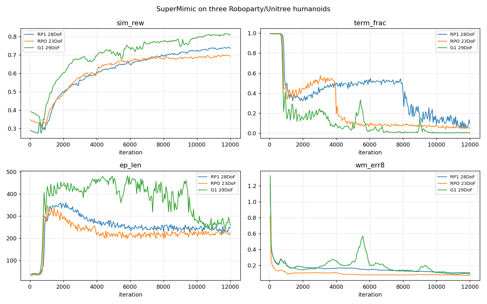

# RP1 迁移 — 进度与交接

> 更新时间：2026-10-29 20:30（RP1 4096 envs 出 0.714/3；Mars_v3 接入但未收敛）
> 服务器：`ssh -p 31744 root@183.147.142.40`（RTX 4090 24GB，驱动 575 / CUDA 12.9）
> 工作区：`/root/gpufree-data/mars`
> 本地 helper：`supermimic/remote_exec.py`（paramiko 密码登录；本机公钥已重新加回服务器）
> 代码仓库：https://github.com/track-tech/SuperMimic-RoboParty-RP1-（公开，main）

---

## 本次会话总结（2026-10-29，一天的事）

### 结果一览（同一套 40 段 eval_mode 评测）

| 机器人 | DoF | 参考数据 | envs | 轮数 | 最佳 ckpt | norm_return | 失败 |
|---|---|---|---|---|---|---|---|
| Unitree G1 | 29 | 上游 | 2048 | 12000 | 6000 | **0.774** | 5/40 |
| RP1 | 28 | 旧（脚埋地 3 cm） | 2048 | 12000 | 12000 | 0.647 | 8/40 |
| RP1 | 28 | 新（对齐 + 足端偏移） | 2048 | 12000 | 10000 | 0.659 | 6/40 |
| RP1 | 28 | 新 | 4096 | 12000 | 12000 | 0.714 | 3/40 |
| RP1 | 28 | 新 | 4096 | 20000 | 20000 | 0.750 | **2/40** |
| **RP1** | **28** | **新** | **4096** | **30000** | **26000** | **0.758** | **3/40** |
| RPO | 23 | 旧 | 2048 | 12000 | 12000 | 0.557 | 11/40 |
| Mars_v3 | 6（点足） | 新（重定时 + 逐帧落根） | 4096 | 12000 | — | 未收敛 | — |

**结论：RP1 最终 0.758 / 3-40（26000 轮），G1 是 0.774 / 5-40**——回报追到只差 0.016（2%），
失败段数比 G1 少 2 段。如果按"失败少"挑，20000 轮那版是 0.750 / **2-40**（只剩两段舞蹈，
`dance1_subject2` 和 `dance2_subject4`）。

同一次训练从头到尾的评测（**必须按评测挑 ckpt，曲线不可靠**）：

| iter | 12000 | 16000 | 18000 | 20000 | 24000 | 26000 | 28000 | 30000 |
|---|---|---|---|---|---|---|---|---|
| norm_return | 0.714 | 0.696 | 0.717 | 0.750 | 0.734 | **0.758** | 0.679 | 0.731 |
| 失败 | 3 | 5 | 5 | **2** | 5 | 3 | 7 | 5 |

### 这一天的四件事

1. **修掉一个影响所有参考数据的 bug**：落地对齐原来用"刚体原点"，而脚是胶囊/网格，
   原点比鞋底高 2–6 cm → RP1 的参考 **100% 的帧穿地**（中位 −3.2 cm）、RPO 99%。
   改成对一个临时平面算 `mj_geomDistance` 的精确最低点后：穿地 0%、最低点 +3 mm。
   **这个 bug 和"腿太长导致悬空"互相抵消，所以旧数据看起来"能用"。**

2. **RP1 的 IK 参数重调**：`human_scale_table` 0.9 → 0.82（RP1 腿 0.75 m，0.9 的配置要求
   0.81 m 够不到）、`base_link` pos_weight 100 → 10（别死盯骨盆）、foot pos_weight 50 → 150、
   足端 z 偏移 **−0.07**（人的踝在鞋底上方 7.5 cm，RP1 只有 3 cm）。
   结果：走路的贴地率 12% → **76.5%**，base_z 0.739 → 0.770。

3. **4096 envs 是免费的**：实测峰值显存 16.5 GB（2048 是 14.2 GB），边际只有 ~1.1 MB/env
   （之前的线性外推 24 GB 是错的）；it/s 1.63 vs 1.69，只慢 4%。收益 +0.055 回报、失败 6→3。
   **注意两个训练不能并行**：4096×RP1 + 1024×Mars 直接 OOM。

4. **Mars_v3（6 DoF 点足）接进来了，但训不动**——详见第十二节。根因不是代码，是
   **这份 IK 参考对点足机器人不动态可行**：即使策略输出恒为 0（完全跟随参考）也 0.32 s 摔倒。

### 当前在跑（2026-10-30 02:20 — 全部结束）

- **RP1 30000 轮已跑完**（01:48 退出，`exit=0`），最佳是 **26000 轮：0.758 / 3-40**
- 服务器已无训练进程，**这台机器可以随时到期了**——所有产物都在本地
  `supermimic/_server_archive/`（1.6 GB，见 `LOCAL-ARCHIVE.md`），最后拉的是
  `rp1_30k_ckpt026000.pt`、`rp1_30k_ckpt030000.pt`、`rp1_30k_last.pt`（可续训）
- Mars 已停：4096 envs × 1200 轮后 ep_len 仍 16.0、term 0.996，确认不是"训得不够久"

### 本地存档（算力机到期保险）

`supermimic/_server_archive/`，共 1.37 GB，详见 `LOCAL-ARCHIVE.md`：
全量包 425 MB + 关键子集 191 MB + RP1 40 段动作 97 MB + Mars 40 段 6 MB，
含 4 个 checkpoint（最好的是 `rp1_20k_ckpt020000.pt`）和 `last.pt`（可续训）。

### 下一步（按优先级）

1. 30000 轮跑完 → 评 24000/28000/30000（20000 轮时 0.750，已经只差 G1 0.024，且失败数更少）
2. 若 Mars 仍不收敛：改参考构造（ZMP 一致落脚点 + 两连杆逆解），或加"先站稳"的 curriculum
3. 奖励常数实验（`soft_limit_factor` 1.0、`w_joint_limit` −1.0、`w_action_rate` −0.05、`body_ori_std` 0.3）

---

## 零、重要更正：之前那个机器人是 RPO，不是 RP1

第一轮（10-28 20:14 训完、本文档第三节之前的所有数字）训的其实是 **Roboparty RPO
（"Origin"，23 DoF）**，不是 RP1。证据：

| | 训练用的（RPO） | 真正的 RP1 |
|---|---|---|
| MJCF model 名 | `rpo` | `rp1` |
| 关节数 | **23**（6+6 腿，腰只 yaw，5+5 臂，无腕） | **28**（6+6 腿，腰 roll+yaw，每臂 7 个含 3 个腕） |
| 质量 | 33.76 kg | **40.7 kg** |
| 关节命名 | `thigh_yaw/roll/pitch`、`arm_pitch/roll/yaw`、`elbow_pitch/yaw` | **G1 风格** `hip_pitch/roll/yaw`、`shoulder_pitch/roll/yaw`、`elbow`、`wrist_roll/yaw/pitch` |
| `base_link.STL` md5 | `1ebaf367…` | `d327e548…` |

成因：下载 `RP1_description` 时 tar 包**截断在 11.9 MB**（`tar: Unexpected EOF`），只解出
`meshes/` 的一小部分、没有 `urdf/` 和 `mjcf/`；于是退用完整可用的 `rpo_description`，
并把目录命名为 `ext/rp1/`，错误从此固化。GMR（Roboparty 自己的 fork）里也只有
`bvh_lafan1_to_rpo.json`，进一步加深了误会。

**现在的状态**：真 RP1 的 40 段动作已重定向完（28 DoF），训练 10-28 23:57 → 10-29 02:20 跑完
（`RP1SuperMimic/2026-10-28_23-57-55_mjwarp`），**最佳是 ckpt_010000：norm_return 0.647、8/40 失败**，
介于 G1（0.774、5/40）和 RPO（0.557、11/40）之间——28 DoF 的真机确实比 23 DoF 的 RPO 学得好。
RPO 那套结果全部保留（配置改名为 `rpo_super_mimic` / `SUPERMIMIC_ROBOT=rpo`，可复跑）。

**资产目录已改名**：`assets/robots/rpo/` = RPO（旧）、`assets/robots/rp1/` = 真 RP1（新）；
运动数据同理 `assets/motions/rpo/`、`assets/motions/rp1/`。

---

## 零之二、三方对比（同一套评测协议，40 段动作 / eval_mode）

| 机器人 | DoF | 最佳 ckpt | norm_return | 失败段数 | 非摔倒类成功率 |
|---|---|---|---|---|---|
| Unitree G1 | 29 | 6000 | **0.774** | **5/40** | 35/36 = 97% |
| **Roboparty RP1** | **28** | **10000** | **0.647** | **8/40** | **34/37 = 92%** |
| Roboparty RPO | 23 | 12000 | 0.557 | 11/40 | 28/32 = 88% |

RP1 的 8 段失败：`fallAndGetUp1_1`、`fallAndGetUp1_4`、`fallAndGetUp2_2`（3 段摔倒起身，
G1 也失败）、`dance1_subject1`、`dance2_subject4`、`fightAndSports1_subject1`、`jumps1_subject2`、`run2_subject1`。

RP1 各 checkpoint：6000 → 0.551/13 段；**10000 → 0.647/8 段**；12000 → 0.630/11 段（过拟合式退化）。



**训练曲线的关键差异**：RP1 的 `term_frac` 从 1000 到 8000 轮一直卡在 0.4–0.5（RPO 是 4000 轮就
掉到 0.19，G1 是 1000 轮掉到 0.22），8000→10000 轮才突然掉到 0.09。也就是说
**RP1 前 2/3 的训练都在"学会不摔"，之后才转向跟踪**，这也解释了为什么最佳 ckpt 在 10000 而不是更早。

---

## 零之三、真 RP1（28 DoF）移植记录

真 RP1 的 `RP1_description`（master 分支，22.5 MB）里有：
`mjcf/{robot.xml, robot_24dof.xml, robot_hand.xml, rp1_flat.xml, rp1_rough.xml}`、
`urdf/{rp1, rp1_24dof, rp1_hand, rp1_hand_fixed}.urdf`、30 个 STL。
用的是 28 DoF 的 `robot.xml`（`nq=35 nv=34 nu=28 nbody=30`，40.7 kg）。

**1) 资产**（`ext/prep_rp1_real.py`）
- `assets/robots/rp1/{rp1_supermimic.xml, scene_supermimic.xml, meshes/}`
- `<motor>` → `<position>`，按力矩分档给 kp/kv：**140 N·m → kp 90**、64/55 → kp 45、32 → kp 25
  （kv = 4·kp/ω_n ≈ kp·0.0637），`ctrllimited="false"` + `forcerange` 取原 motor 的 ctrlrange
- `meshdir="../"` → `"./"`（网格按 `meshes/x.STL` 引用，目录结构照搬）
- 补 `<keyframe name="stand">`：**全零姿态**（直腿，和 G1 一样；base z=0.78）
- 原 MJCF 已经是 `solver="Newton" + implicitfast + timestep 0.005`，mjwarp 直接能吃
- 原 MJCF 有 45 个具名 `*_collision` geom → 摩擦随机化可以正常绑定（RPO 是补的名字）

**2) 重定向**（一键脚本 `_setup_rp1_retarget.sh`）
- `bvh_lafan1_to_rp1.json` = 照抄 G1 的 IK 配置，只改两个刚体名：
  `pelvis → base_link`、`torso_link → waist_yaw_link`（其余 12 个刚体名 RP1 全有）
- GMR `params.py` 注册 `rp1`，`GMR/assets/rp1/` 放模型 + 网格
- 40 段全部重定向完成（138–157 fps，10 进程并行约 6 分钟）

**3) 代码**（`SUPERMIMIC_ROBOT=rp1`）
- `robot.py` 改成**三档开关**：`g1`（默认，29 DoF）/ `rpo`（23 DoF）/ `rp1`（28 DoF）
- 新 `robot_rp1.py`：28 关节表、14 跟踪刚体、45 个碰撞 geom、力矩表、`TORSO_BODY_NAME`
- 旧profile 存为 `robot_rpo.py`（**注意名字里的 G1**：三个模块都沿用了 `G1_JOINT_NAMES`
  这个变量名，这样 `kinematics.py` / `manager_terms.py` 一行都不用改）
- **新增坑**：`manager_terms.py` 把 `find_bodies("torso_link")` 写死了（给躯干加 CoM 随机化），
  RP1 的躯干叫 `waist_yaw_link` → 加了 `TORSO_BODY_NAME` 到 profile，代码改成用它

**4) 配置**
- `conf/.../task/rp1_super_mimic/base.yaml`：28 关节、14 刚体、`context_dim: 32`、
  `mjcf_path: robots/rp1/rp1_supermimic.xml`、40 段 `motions/rp1/**`
- 旧的（RPO）配置克隆为 `task/rpo_super_mimic/`，`task_name: RPOSuperMimic` 并注册
- 维度自动推导结果：**obs 96 / xi 32 / goal 71 / critic_extra 111**（G1 是 99/33/73/113）

**5) 参考动作质量**（40 段 / 264705 帧，RP1 28 关节）

| 关节 | 中位数 | p05..p95 | 备注 |
|---|---|---|---|
| 左/右 hip_pitch | ∓0.78 | −1.89..+1.86 | 镜像符号，余量充足 |
| 左/右 knee | ∓0.97 | −2.19..+2.14 | 限位 ±2.83，**没有饱和**（RPO 是顶到限位） |
| ankle_roll | ∓0.04 | ±0.26 | **有动作了**（RPO 那条恒 0） |
| wrist_pitch | 0 | 0 | 末端关节无参考（和 RPO 的 ankle_roll 同类问题，影响小） |
| base z | 0.739 | 0.28..1.00 | 摔倒起身段会贴地 |

**6) 过程坑**
- 我在重定向批次跑着的时候把 `assets/robots/rp1_real` 改名成 `assets/robots/rp1`，
  把 GMR 的 meshes 软链断了 → 17 段报 `Error opening file 'meshes/…STL'`，
  修好链接后补跑。**教训：批处理在跑时不要动资产目录。**
- `manager_terms.py` 里 `find_bodies("torso_link")` 写死 → 加 `TORSO_BODY_NAME`（见上）。
- RP1 的 `robot.xml` 开头有 `<?xml version="1.0"?>`，渲染时内联进 scene 会变成**文档中间的
  XML 声明**，MuJoCo 报 `XML_ERROR_PARSING_DECLARATION`。`comparison_xml()` 里要把声明一并剥掉。

**7) 一次失败的诊断（记录以免重犯）**

RP1 训练到 8000 轮时 `term_frac` 还卡在 0.4，我怀疑是位置伺服刚度不够、腿被重力压塌，
于是做"开环喂参考动作"测试，看到机器人 3 秒后高度只剩 0.09 m、躯干还竖着，判断是腿塌了。
**这个结论是错的**，两个测试都不成立：

- 开环喂走路参考动作**本来就会倒**：参考的根节点轨迹没有一起施加，脚在地上的位置和参考不
  一致，等于"原地踏步"，任何平衡控制器都得倒。
- 后来做了静态蹲姿保持测试：**膝盖实际值 −0.88…−0.91，指令是 −0.90**，说明伺服跟得很好，
  根本没有"塌陷"。那个测试里机器人倒掉是因为我给的是一个任意蹲姿、CoM 不在支撑多边形内。

真正的原因是训练本身慢：8000→10000 轮 `term_frac` 自己掉到了 0.09。**结论：kp 没问题，
现有 90/45/25 够用**（但仍是按力矩比例估的，没有像 RPO 那样做过站立扫描，属于"能用但没验证"）。
后来我修 gain-scale 测试脚本时还发现一处 bug：position 执行器是
`gainprm=[kp,0,0]`、`biasprm=[0,-kp,-kv]`，只改 `biasprm[2]` 而不改 `biasprm[1]=-kp`
会把伺服变成"弹到零位"，测试结果完全无效——第一版 gain 扫描就是这么废掉的。

---

## 一、RPO 第一轮（23 DoF，历史记录，配置现名 `rpo_super_mimic`）

**SuperMimic 在 RPO 上跑通了**：40 段 LAFAN1 动作全部重定向，2048 envs × 12000 轮训练，
2 小时 10 分完成，确定性评测 **40 段里 29 段成功跟踪**（G1 是 35/40）。
失败的 11 段里 7 段是 `fallAndGetUp*`（本来就是"摔倒再爬起来"，G1 也失败），
所以**非摔倒类动作的成功率 RPO = 28/32 = 87.5%，G1 = 35/36 = 97%**。


| 阶段 | 状态 |
|---|---|
| A. MJCF 适配 | ✅ rev2（forcerange、meshdir、Newton solver、kp 实测选定） |
| B. 任务配置 | ✅ 含 backend overlay、task 注册、context_dim=27 |
| C. 动作重定向 | ✅ 40/40，帧数与 G1 完全一致 |
| D-1. 代码移植 | ✅ robot profile 机制，smoke test 通过 |
| D-2. 训练 | ✅ 12000 轮跑完，`term_frac` 0.997 → **0.050** |
| E. 评测 + 渲染 | ✅ 全库评测 + G1/RPO 同段对照视频 |

**第一轮数字**（配置现名 `rpo_super_mimic`）：

| checkpoint | norm_return | 失败段数 | 失败清单 |
|---|---|---|---|
| RPO `ckpt_006000` | 0.526 | 14 | dance1_1, dance2_4, fallAndGetUp1_{1,4,5}, fallAndGetUp2_{2,3}, fallAndGetUp3_1, fight1_{2,3,5}, fightAndSports1_4, jumps1_2, walk3_4 |
| RPO `ckpt_010000` | 0.549 | 13 | 同上，少 fight1_5 |
| **RPO `ckpt_012000`** | **0.557** | **11** | dance1_1, dance2_4, fallAndGetUp1_{1,4,5}, fallAndGetUp2_{2,3}, fallAndGetUp3_1, fightAndSports1_4, jumps1_2, walk3_4 |
| G1 `ckpt_006000` | **0.774** | **5** | fallAndGetUp1_{1,4,5}, fallAndGetUp2_2, walk3_4 |

**和 G1 不同：RPO 是越训越好（6000→12000 从 14 段降到 11 段），G1 在 6000 轮后反而退化。**


曲线里最值得注意的一点：**RPO 的世界模型更准**（`wm_err8` 0.07–0.10，G1 是 0.09–0.20，
因为 23 DoF 比 29 DoF 简单），但策略表现更差（`sim_rew` 稳定在 G1 的 ~87%）。
所以差距不在世界模型，而在**参考动作的可行性和机器人自身的自由度**（见第六节诊断）。

---

## 二、G1 基线（对照物，已完成）

| 项 | 结果 |
|---|---|
| 训练规模 | 12000 轮 × 2048 envs，2 小时 15 分，零报错 |
| 摔倒率 `term_frac` | 99% → **0.4%** |
| 归一化回报 `ep_ret_norm` | 0.356 → 0.506（峰值 0.670 @ 6000 轮） |
| 世界模型误差 `wm_err8` | 0.22 → 0.26（4000 轮冲高）→ **0.092** |
| 产出 | `ext/g1_best.mp4`、`ckpt_006000.pt` |

G1 的关键节点（对比 RP1 时用）：

```
iter    term    ret   wm_err8  ep_len
 500   0.994  0.352   0.208     37.7
1000   0.222  0.355   0.217    398.4     ← 崩溃期结束
2000   0.140  0.558   0.139    441.8
4000   0.079  0.659   0.258    465.3
6000   0.017  0.670   0.197    444.0     ← 最佳
12000  0.004  0.506   0.092    258.1
```

---

## 三、阶段 C：动作重定向（已完成）

### 关键事实：官方已经支持 RP1

`Roboparty/GMR`（`YanjieZe/GMR` 的 fork）里预置了 RP1：

```
general_motion_retargeting/ik_configs/bvh_lafan1_to_rpo.json   ← LAFAN1 BVH → RP1 的 IK 配置
assets/rpo/{rpo.xml, rpo.urdf, meshes/24 STL}
ik_config_manager/pose_inits/rpo.json
```

`params.py` 里 `ROBOT_XML_DICT["rpo"]` 与 `IK_CONFIG_DICT["bvh_lafan1"]["rpo"]` 都在，
是官方手调过的配置（虽然 README 表格里 BVH 列写着 TBD——配置存在但测试不充分）。

### 下载技巧（重要）

| 资源 | 走法 |
|---|---|
| GMR 仓库（37 MB tar） | 服务器 `codeload.github.com` 只有 35 KB/s 且会截断；**本地 Windows 直连 GitHub 8 MB/s**，本地下载 → `scp` 上传（2.7 MB/s，14 秒） |
| LAFAN1 BVH（40 段 186 MB） | 服务器不通 HF；本地走 `hf-mirror.com`（1.6–5.7 MB/s），HF 数据集 `johnny095212/lafan1` 有全部 77 段。注意 8 线程并发会 429，重跑一次即可 |
| GMR 的 python 依赖 | 阿里云 pypi 镜像，31 秒装完（mujoco 3.17 / mink 1.3.0 / scipy / daqp） |

服务器位置：`ext/GMR/`、`ext/lafan1_bvh/`（40 段）、`ext/rp1_motions/`（40 CSV + 40 NPZ）。

### 重定向脚本（自己写的）

原版 `scripts/bvh_to_robot.py` 依赖 MuJoCo 窗口 + `termios` 读键盘，ssh 下跑不了。
写了 `ext/retarget_rp1.py`（本地 `supermimic/retarget_rp1.py`）：

- 直接调 `GeneralMotionRetargeting(src_human="bvh_lafan1", tgt_robot="rpo")`
- 自己用 mujoco 算最低点做落地对齐（原版靠 `KinematicsModel`，那需要 torch）
- CSV = 3 位置 + 4 四元数（**xyzw，与 G1 的 CSV 一致**）+ 23 关节 = **30 列**，30 fps
- 同时存 npz（含 dof_names 便于检查）

```bash
cd /root/gpufree-data/mars/ext
/root/gpufree-data/mars/gmr-env/bin/python retarget_rp1.py \
  --bvh_dir lafan1_bvh --out_dir rp1_motions --robot rpo
```

### 结果验证

| 项 | G1 | RP1 |
|---|---|---|
| dance1_subject1 帧数 | 3945 | **3945**（完全一致） |
| CSV 列数 | 36 | 30（7 + 23） |
| 基座高度均值 | 0.753 m | 0.750 m |
| 单段耗时 | — | 138 fps（≈30 s/段），10 进程并行 40 段 ≈ 4 分钟 |

### 已知缺陷：ankle_roll 恒为 0

`bvh_lafan1_to_rpo.json` 的脚部 IK target 用的是 `left_ankle_roll_link` 的**父节点**
`left_ankle_pitch_link`（G1 用的是 `left_ankle_roll_link`），于是 `ankle_roll` 关节
没有任何 task 拉它，40 段动作里**恒等于 0**。

试过的修法：把 foot target 换成 `ankle_roll_link`（与 G1 一致）——结果更差：
`ankle_roll` 直接顶到 ±0.5 rad 关节限位（span 恒为 1.0），基座高度从 0.750 掉到 0.667，
说明这个自由度被拿去凑位置误差了。**已回滚**，保留官方配置。

影响：参考动作里 ankle_roll 恒 0 → 奖励会鼓励策略不使用这个自由度。对"验证 SuperMimic
在 RP1 上能不能跑起来"够用；要更好效果应重新设计脚部 IK task（给 roll link 单独加只含
旋转权重的 task——但 GMR 的 task 表以人类骨骼名做 key，同一个 `LeftFootMod` 加两条会被覆盖，
得改 `motion_retarget.py`）。

---

## 四、阶段 A rev2：MJCF 的关键修正

上一版（rev1）有三个问题，都已修：

1. **`ctrlrange` 用错**。`<position>` 的 `ctrlrange` 限制的是**位置目标**；G1 的写法是
   `forcerange`（限力矩、不限目标）。改成 `ctrllimited="false" forcerange="-120 120"`。
2. **`meshdir` 错**。原文件是 `../meshes/`（在 `ext/rp1/mjcf/` 下是对的，搬进
   `assets/robots/rp1/` 后 STL 就在同目录）→ 改成 `./`。
   不改会 `Error opening file ../meshes/...`。
3. **`solver="PGS"` 不被 mjwarp 支持** → `NotImplementedError: mjSOL_PGS is unsupported`
   → 改成 `solver="Newton"`。

另外**上一版"站住了"的结论是错的**：当时只跑 200 步 = 0.2 秒，而 0.92 m 起落 0.19 m
正好是 0.2 秒自由落体的距离。真实测试（先落地、再跑 3 秒）：

| kp/kv（大局 / 小局） | 3 秒后躯干 up 分量 | 结论 |
|---|---|---|
| 39.5/2.5（armature 0.01 自然频率约定） | −0.05 | 倒 |
| 79/5 | −0.05 | 倒 |
| 85/5，19/1.2 | −0.07 | 倒 |
| **150/5，40/1.5** | **+0.95** | **站住 3 秒** |
| 250/8，60/2.5 | +0.19 | 倒（太硬，1 ms 步长不稳） |

所以取 **kp=150/kv=5（120 N·m 组）、kp=40/kv=1.5（27 N·m 组）**，用 `forcerange` 限幅。
kp=150 相当于 armature 0.038，比 MJCF 声明的 0.01 硬 3.8 倍——RP1 是 33.8 kg 却有 120 N·m
执行器，自然频率约定给不出能站住的刚度。`robot_rp1.py` 里的 armature 反过来按 kp=150/40
定义，保证 `action_scale()` 语义一致（≈25% 力矩对应的位置增量）。

跑 5 秒会慢慢倾倒——这个 stand 站姿不是静态稳定的。**影响很小**：SuperMimic 的 reset 从
参考动作取状态，`stand` keyframe 只用于 `default_joint_pos`（动作中心）。

---

## 五、阶段 D-1：代码移植

原版把 G1 写死得很彻底。所有改动**向后兼容**（不设环境变量即为 G1）：

### 1. robot profile 开关

新增 `src/.../supermimic/robot_rp1.py`（23 关节表、14 跟踪刚体、力矩表、站姿、24 个
collision geom 名），`robot.py` 末尾追加：

```python
ROBOT_PROFILE = os.environ.get("SUPERMIMIC_ROBOT", "g1").lower()
if ROBOT_PROFILE in ("rpo", "rp1"):
    from .robot_rp1 import (...)   # 同名覆盖 G1_JOINT_NAMES / TRACKED_BODIES / ...
else:
    ROOT_BODY_NAME = "pelvis"
```

`kinematics.py` / `manager_terms.py` 一行没改——它们本来就是
`from .robot import G1_JOINT_NAMES, TRACKED_BODIES`，覆盖同名变量即可。

### 2. 维度从常量改成推导

`mdp.py` 原来是 `NUM_J = 29; OBS_DIM = 29+29+3+3+29+6; XI_DIM = 33; ...`：

```python
NUM_J = len(JOINT_NAMES)                              # 23 (G1: 29)
NUM_TRACKED = len(TRACKED_BODIES)                     # 14
OBS_DIM = 3*NUM_J + 3 + 3 + 6                         # 81 (G1: 99)
XI_DIM = NUM_J + 4                                    # 27 (G1: 33) = [摩擦, 关节偏移, 躯干ipos×3]
GOAL_FRAME_DIM = 15 + 2*NUM_J                         # 61 (G1: 73)
CRITIC_EXTRA = NUM_J + 3*NUM_TRACKED + 3 + 6 + XI_DIM  # 101 (G1: 113)
```

`motion.py` 的 `36 列` 改成 `7 + NUM_J`；`manager_terms.py` 里 6 处
`context[:, 1:30]` / `xi[:, 30:33]` 改成 `1+NUM_J` 形式；`tensor_body_names`
从写死的 `("pelvis",)` 改成 `(ROOT_BODY_NAME,)`。

### 3. 其它必须的三处

- **task 注册**：`registry.py` 加 `TASK_NAMES = ["G1SuperMimic", "RP1SuperMimic"]`，
  否则 `ValueError: Environment 'RP1SuperMimic' is not registered`
- **backend overlay**：hydra 的 task 组是 `task/<robot>/<backend>`，
  补 `conf/supermimic/task/rp1_super_mimic/{mjwarp,mujoco}.yaml`
  （`task_name: RP1SuperMimic`、`sim_backend: mjwarp`、`mjwarp_nconmax: 128`、`mjwarp_njmax: 500`）
- **geom 命名**：RP1 的 24 个 geom **全都没有名字**，而 SuperMimic 的 context event 要按
  名字随机化摩擦 → mjwarp 报 `capability 'reset geom-friction write' is unavailable`。
  用 `name_rp1_geoms.py` 给非视觉 geom 补 `<mesh名>_collision`，写进 `COLLISION_GEOM_NAMES`

### 4. 任务 yaml 的四处

```
root_body_name: base_link                       （原 pelvis）
mjcf_path: .../robots/rp1/rpo_supermimic.xml    （原 g1/supermimic.xml）
context_dim: 27                                 （原 33）
motion_files: 40 个 rp1 csv
```

### smoke test

```
task=rp1_super_mimic/mjwarp algo.num_envs=4 algo.iterations=3
→ 3 iterations, 284 sim steps, 42 s，正常写出 ckpt
→ term_frac 100%, ep_ret_norm 0.334, wm_err8 0.219
```

与 G1 第一轮起点（term 99.5%、ret 0.362、wm_err8 1.33）几乎一致，说明移植没走偏。

---

## 六、阶段 D-2：训练

```bash
cd /root/gpufree-data/mars/ext/Uni-SuperMimic-repo
HF_HUB_OFFLINE=1 SUPERMIMIC_ROBOT=rpo \
  /root/gpufree-data/mars/usm-env/bin/python -m unisupermimic.scripts.train_supermimic \
  task=rp1_super_mimic/mjwarp algo.num_envs=2048 algo.iterations=12000
```

`ext/_train_rp1.sh` 是封装；日志 `ext/rp1_train.log`，进度 `ext/_rp1_progress.sh`。

速度：前 500 轮是 `wm_only_iters`（只训世界模型）3.1 iter/s，之后 1.5–1.7 iter/s
（和 G1 的 1.48 一样），全程约 2 小时 10 分。

### 训练过程中的对照（**以 `sim_rew` 为准，不要看 `ep_ret_norm`**）

| iter | RP1 sim_rew | G1 sim_rew | RP1 term | G1 term | RP1 ep_len | G1 ep_len |
|---|---|---|---|---|---|---|
| 1000 | 0.345 | 0.434 | 0.479 | 0.222 | 274 | 398 |
| 2000 | 0.491 | 0.602 | 0.450 | 0.140 | 291 | 442 |
| 3000 | 0.572 | 0.679 | 0.529 | 0.244 | 246 | 409 |
| 4000 | 0.609 | 0.694 | 0.193 | 0.079 | 213 | 465 |
| 5000 | 0.647 | 0.718 | 0.086 | 0.099 | 220 | 445 |
| 12000 | 0.757 | 0.809 | 0.050 | 0.004 | 224 | 258 |

**注意 `ep_ret_norm` 在 RP1 这条日志里不可比**：RP1 显示 0.018、G1 显示 0.646，
但两者的 `sim_rew`/`ep_len` 差距远没那么大。`sim_rew`（每步回报 / 最大步回报）才是
可比指标，且 `imag_rew ≈ sim_rew`、`imag_survival ≈ 0.97` —— **没有世界模型被利用的迹象**
（这一点和 Mars_v3 上的崩坏形成对照）。

### 确定性全动作库评测（`evaluate.py --ckpt`，40 段动作 / eval_mode）

| checkpoint | norm_return | 失败段数 |
|---|---|---|
| G1 `ckpt_006000` | **0.774** | **5 / 40**（5 段里 4 段是 fallAndGetUp） |
| RP1 `ckpt_002000` | 0.333 | 22 / 40 |
| RP1 `ckpt_004000` | 0.483 | 15 / 40 |
| RP1 `ckpt_006000` | 0.526 | 14 / 40 |
| RP1 `ckpt_010000` | 0.549 | 13 / 40 |
| **RP1 `ckpt_012000`** | **0.557** | **11 / 40** |

RP1 最终 11 段失败：`fallAndGetUp1_{1,4,5}`、`fallAndGetUp2_{2,3}`、`fallAndGetUp3_1`
（7 段摔倒起身，G1 同样失败）、`dance1_subject1`、`dance2_subject4`、
`fightAndSports1_subject4`、`jumps1_subject2`、`walk3_subject4`。

→ **非摔倒类动作：RP1 28/32 成功，G1 35/36 成功**。
→ 趋势相反：RP1 一路变好（14→11），G1 在 6000 轮后反而退化（见第二节）。

### 为什么 RP1 比 G1 差（诊断）

1. **参考动作是个更深的蹲姿**。对同样的 40 段动作做统计（264705 帧）：

   | | G1 | RP1 |
   |---|---|---|
   | 髋/大腿 pitch 中位数 | −0.39 | **−0.78** |
   | 膝 中位数 | +0.76 | **+1.04** |
   | ankle_pitch 第 5 百分位 | −0.22 | **−0.60（＝硬限位）** |
   | ankle_roll | ±0.05（有动作） | **恒 0** |

   来源是 `bvh_lafan1_to_rpo.json` 的 `human_scale_table` 腿长系数 **0.8**（G1 用 0.9），
   髋高目标被压得更低，膝关节只能一直弯着；膝盖弯 60° 时踝关节更容易顶到 ±0.6 限位。

2. **关节软限位惩罚与参考动作冲突**。`soft_limit_factor=0.9` 时，RP1 参考动作有
   **83% 的帧至少一个关节在软限位外**（G1 是 40%），主因是大腿 roll 的**非对称窄范围**
   `[-0.2, +1.0]`（参考动作中位数 −0.11，紧贴内限）。每帧的超出量只有 0.03–0.06 rad，
   惩罚幅度不大，但方向上是"跟着参考走就被罚"。

3. **自由度更少**：23 DoF vs 29，没有腕关节、腰只有 1 个自由度（G1 有 3 个），
   躯干姿态只能靠一个 joint 摆平。

4. `ankle_roll` 恒 0（第三节）——侧向支撑缺一个主动自由度。

**可验证的改进方向**（下次做）：把 `human_scale_table` 的腿长系数 0.8 → 0.88 重新重定向
（只需 4 分钟），让参考站姿站直一些；再考虑 `soft_limit_factor` 提到 1.0 或
`w_joint_limit` 调小。


---

## 七、环境与坑

**两个虚拟环境**：

| 路径 | 用途 | 关键包 |
|---|---|---|
| `usm-env` | 训练/渲染（py 3.11） | torch 2.9.0+cu128、triton **3.4.0**、unilab 1.5.2、mujoco 3.11、onnxruntime |
| `gmr-env` | 重定向（py 3.12） | mujoco 3.17、mink 1.3.0、scipy、daqp、Cython、imageio |

**必须记住的坑（每条都踩过）**：

1. **torch 必须配 triton 3.4.0**，否则 `torch.compile` 报
   `KernelMetadata has no attribute 'cluster_dims'`。
2. **pypi 走阿里云镜像** `--index-url https://mirrors.aliyun.com/pypi/simple`。
3. **HuggingFace 不通**：`HF_HUB_OFFLINE=1`；G1 网格要预置到
   `site-packages/unilab/assets/robots/g1/assets/`。
4. **`type="hinge"` 筛不出关节**——RP1 用 `<default class>` 隐式给类型，要从 actuator 反查。
5. **render 的 `--fps` 必须是 50 的因子**（25 或 50）。
6. **GMR 的 `setup.py` 依赖 `smplx @ git+github`**，服务器不通 → 别 `pip install -e .`，
   直接 `sys.path.insert(0, "/root/.../GMR")`。
7. **GMR 的 `__init__.py` 会 import viewer 和 `kinematics_model`**（要 imageio / torch）
   → 已把这两行包进 `try/except ImportError`，headless 就能用。
8. **mjwarp 不支持 `mjSOL_PGS`**，MJCF 必须用 Newton/CG。
9. **PowerShell 会吃掉 `$D`、`$X`、`[` `]`、引号**——凡含 `$`/`[]`/中文的命令，一律写成
   `.sh` 文件再 `python remote_exec.py --file xxx.sh`。
10. **`Get-Content` + `Set-Content` 会干掉中文**（ANSI 读、UTF-8 写、加 BOM）。中文文件只用
    `write`/`edit` 工具改（这条 20:50 又踩了一次，文档被毁后重写）。

**网络现状**：pypi(阿里云) ✅、`codeload.github.com` ✅(35 KB/s，大文件走本地)、`gitee` ✅；
`github.com`/`huggingface.co`/`download.pytorch.org` ❌。
本地 Windows 反过来：**GitHub 直连 8 MB/s**、`hf-mirror.com` ✅。

---

## 八、资产清单

> **工程代码已同步到 GitHub**：https://github.com/track-tech/SuperMimic-RoboParty-RP1-
> （59 个文件 / 1.2 MB，`main` 分支；只含补丁 + 配置 + 脚本 + 文档，网格/动作/ckpt/视频由
> `scripts/setup/*` 重新生成。README 里有 6 步复现流程。）

| 路径 | 内容 |
|---|---|
| `ext/Uni-SuperMimic-repo/` | 已移植的代码（G1 + RP1 双 profile） |
| `ext/GMR/` | 完整 GMR 仓库（37 MB）+ rpo 资产 |
| `ext/lafan1_bvh/` | 40 段原始 LAFAN1 BVH（186 MB） |
| `ext/rp1_motions/` | 40 段 RP1 参考动作 CSV + NPZ |
| `ext/rp1/` | RP1 原始资产（urdf / mjcf / 24 STL） |
| `ext/retarget_rp1.py` `tune_rp1_gains.py` `test_rp1_stand.py` `search_stand_pose.py` `name_rp1_geoms.py` | 本次写的工具 |
| `ext/_train_rp1.sh` `_rp1_progress.sh` `_render_rp1.sh` `_smoke_rp1.sh` | 跑训练/看进度/渲染/冒烟 |
| `src/unisupermimic/_usm_backup/` | 改动前的 5 个原始文件（可回滚） |
| `ext/g1_best.mp4`、`logs/supermimic/G1SuperMimic/...` | G1 基线 |

---

## 九、下一步

1. **改进参考动作**（收益最大）：`bvh_lafan1_to_rpo.json` 的 `human_scale_table` 腿长系数
   0.8 → 0.88，重定向 40 段（4 分钟），膝盖就不会一直弯 60°；同时给脚部 IK task 换成
   `ankle_roll_link` 需要另想方案（见第三节）。
2. **软限位**：`soft_limit_factor` 0.9 → 1.0，或把 `w_joint_limit` 从 −2.0 调小，
   避免"跟着参考走就被罚"。
3. **从 12000 轮 checkpoint 继续训**（`algo.resume=true algo.load_run=<run>`），
   或用 `algo.iterations=20000` 再拉一版——RP1 到 12000 仍在变好，没收敛。
4. 可选：多段动作的定性对比（walk/run/dance）、`sim2sim` 到 mujoco 后端、
   对比不同 `kp` 组（150 是实测站得住的最小值，值得再扫一次 120/200）。

---

## 十、渲染 / 评测（已打通）

`render.py` 有三个写死的 G1 假设，已修（本地 `supermimic/usm_src/{evaluate,render}.py` 是改后版本）：

1. **`evaluate.py: make_eval_env`** 的 `overrides = [..., "task=g1_super_mimic/{backend}"]` 写死
   → RP1 的 ckpt 报 `CrossBackendIncompatibleError: context_dim 27 vs 33`。
   改成按 run 目录名推断：`task_dir.startswith("RP1") → rp1_super_mimic`。
2. **`render.py: comparison_xml`** 读 `scene.with_name("supermimic.xml")` 且找
   `<body name="pelvis"` → RP1 没这个文件名/刚体名。改成从 scene 的 `<include file="...">`
   推机器人 xml，并取 `<worldbody>` 后第一个 `<body name=` 作根（G1=pelvis，RP1=base_link）。
3. **`render.py: render_comparison`** 的 `data.qpos[:36]` 写死（7+29）→ RP1 是 30 列。
   改成按 `policy.shape[1]` 切分。

### 视频画面问题（"地面有波纹"，已修）

第一版渲染出来地平线附近有一道道波纹，原因是**两个共面的地面在打架**：

- `rpo_supermimic.xml` **自带一个** `<geom name="ground" type="plane" size="0 0 1" pos="0.001 0 0">`
- `scene_supermimic.xml` 又声明了 `<geom name="floor" type="plane" size="0 0 0.05">`（带棋盘贴图）

两层都在 z≈0，深度值打架 → 波纹。G1 的 MJCF 里**没有**自带地面，所以只有 RP1 的视频有这问题。

修法**只改视觉、不动物理**（否则和训练时的动力学不一致）：
`render.py: comparison_xml()` 把 scene 的 `<include>` **内联**替换成"去掉 plane 的机器人 xml"
（注意 `<include>` 引入的是子元素，所以内联时必须去掉 `<mujoco>` 外壳），
这样可视化模型只剩一层地面；物理仿真仍走原场景的两层平面，和训练完全一致。

顺手改的三处：

- `model.vis.quality.offsamples = 4`（4× MSAA），棋盘边缘不再锯齿
- 相机距离 3.6 → 2.6（`SUPERMIMIC_CAM_DIST` 可调），机器人占画面更大
- 地面棋盘对比度调低（`rgb1 0.66 / rgb2 0.615`）、`texrepeat 1.0`

**注意**：`floor` 的 `size="0 0 0.05"` 第三个数是**网格线间距**（MuJoCo 会给 plane 画 5 cm 线框），
渲染时也一并推到 1000（设 0 会被拒绝：`plane size(3) must be positive`）。

### 视频多长

`--seconds` 直接决定长度；`walk1_subject1` 这段动作本身有 261 秒，策略能一直跟住，
所以渲了 **40 秒**。`run1_subject2` 渲了 20 秒。


现成脚本（都在 `ext/`）：

| 脚本 | 作用 |
|---|---|
| `_render_rp1.sh <ckpt> <clip> <sec>` | 渲染一段（默认最新 ckpt），960×540 |
| `_render_sheet.sh <ckpt> <clip> <sec> <tag>` | 1600×900 渲染 + 裁切 2×2 拼图 → `<tag>.png` |
| `_render_sheet_g1.sh <ckpt> <clip> <sec> <tag>` | 同上，G1 版（不设 `SUPERMIMIC_ROBOT`） |
| `_eval_rp1.sh [ckpt]` | 40 段动作确定性评测，输出 JSON（norm_return / n_failed / 失败清单） |
| `_eval_many.sh 6000 10000 12000` | 批量评测 + 紧凑汇总 |
| `make_sheet.py <mp4> <png> [cols] [rows] [crop]` | 从视频抽帧拼图（`crop` 比例裁中心） |
| `hstack_videos.py <left.mp4> <right.mp4> <out.mp4> <labelL> <labelR>` | 两个视频左右拼接（带角标） |
| `_render_final.sh` | 调低地面亮度 + 出三支定版视频（40s walk ×2、20s run） |
| `showcase_rp1.py --ckpt <ckpt> --clips a,b,c --seconds 12` | **一个 env 连渲多段动作**（省掉每段重复建 env），逐段出片 |
| `stitch_showcase.py --out <mp4> --sheet <png>` | 把 `/tmp/showcase_*.mp4` 拼成一条带角标的合集 + 九宫格缩略图 |
| `_showcase.sh [clips] [seconds]` | 上面两步的封装（默认 8 段：walk/run/sprint/jumps/dance/fight/fightAndSports/walk2） |
| **`_render_any.sh <g1\\|rpo\\|rp1> <ckpt> <clip> <sec> <tag>`** | 按 profile 自动选环境变量 + scene，出 1280×720 视频 |
| **`_showcase_rp1real.sh`** / **`_stitch_rp1real.sh`** | 真 RP1 的 8 段合集（渲染 + 拼接两步分开，避免 pyav 缺失） |
| **`_eval_rp1real.sh 6000 10000 12000`** | 真 RP1 的批量评测（`SUPERMIMIC_ROBOT=rp1`） |

**注意**：`render`/`evaluate` 都不是 module，路径是
`src/unisupermimic/tasks/motion_tracking/g1/supermimic/{render,evaluate}.py`；
`SUPERMIMIC_ROBOT` 必须和模型匹配：**G1 不设（默认 g1）、RPO 设 `rpo`、真 RP1 设 `rp1`**，
否则关节表和观测维度对不上。
另外 `showcase_rp1.py` 内部的拼接用了 `imageio.v3 plugin="pyav"`，usm-env 没装该插件 →
实际用法是**先渲段、再用 `stitch_showcase.py`**（它用 ffmpeg reader）。

本地成品：**真 RP1**：**`rp1real_demo.mp4`（11 分钟主演示：走 30s + 跑 30s + 冲刺 20s +
三段完整舞蹈 131s/226s/226s，267 MB）**、`rp1real_demo.png`（六宫格）、
`rp1real_showcase.mp4`（96 秒 8 段动作合集，24 MB）、`rp1real_showcase.png`（八宫格）、
`rp1real_dance.mp4`（90 秒舞蹈合集，6 段 15 秒）、`rp1real_dance.png`、
`rp1real_walk.mp4`（40 秒行走）、
`g1_vs_rp1real_walk.mp4`（G1 与 RP1 并排 40 秒）、`sheet_rp1real_walk.png`、
`three_way_training.png`（G1/RP1/RPO 三方曲线）、`rp1real_train_log.csv`。
**RPO（旧）**：`rp1_showcase.mp4`、`g1_vs_rp1_walk_40s.mp4`、`rp1_walk1_subject1.mp4`、
`g1_vs_rp1_walk.png`、`g1_vs_rp1_training.png`、`rp1_train_log.csv`。
**G1**：`g1_walk1_subject1.mp4`、`g1_train_log.csv`。

---

## 十一、安全

服务器 root 密码在本对话里出现过，**建议换掉**；`/root/.ssh/authorized_keys` 现有 3 行，
第一行是上次会话留下的旧公钥（注释 `dsh-mars` 但指纹不同），可删。

---

## 十二、Mars_v3 接入（第三台机器人，6 DoF 点足）

`SUPERMIMIC_ROBOT=mars`，任务名 `MarsSuperMimic`，配置目录
`conf/supermimic/task/mars_super_mimic/`。

**机器人**：2.19 kg / 腿长 0.234 m / 6 个关节（`abad, hip, knee` × 双腿）/
**无踝、无臂**，脚是 fixed joint 挂在胫骨末端（点足）。

**跟踪刚体只有 7 个**：`base_link, hip_L/R_Link, knee_L/R_Link, foot_L/R_Link`。
维度自动推出来：obs 30、context 10、goal 27、critic 额外 46。

### 为此改了四处（前三台机器人都没用到）

1. **`kinematics.py`**：FK 循环跳过 `body_jntnum == 0` 的刚体 → fixed joint 的脚
   永远不在运动链里，`TRACKED_BODIES` 直接 KeyError。改成：固定刚体也进链，轴线置零
   （`axis=[0,0,0]`），FK 里 `axis_angle(0, q)` 恒为单位阵，等于刚性跟随父刚体。
2. **`mdp.py` 奖励带宽按尺寸缩放**：`body_pos_std` 0.3 → **0.09 m**。0.3 m 对 0.28 m
   高的机器人等于"全身都是容差"，位置高斯一直饱和、没有梯度。
   实现上要给 profile 加 `REWARD_OVERRIDES`，且**必须同时改 dataclass 的
   `__defaults__`**——dataclass 把默认值烘进了 `__init__` 签名，只改类属性无效。
3. **`robot.py`**：profile 开关加 `mars`，并转发 `REWARD_OVERRIDES`。
4. **`evaluate.py`**：`task_dir = run_dir.parent.name.upper()` 是**大写**的，
   所以 Mars 的前缀判断必须写 `startswith("MARS")`（写成 `"Mars"` 会静默退回 G1 配置，
   报 `CrossBackendIncompatibleError: context_dim 10 vs 33`）。

### 动作数据（这条流水线是三台机器人里最讲究的）

```
重定向（scale 0.22） → 重定时 2.1×（Froude 相似） → 逐帧落根 → 40 段
```

- **落地对齐**：全局对齐（整段一个偏移）会让大部分帧悬空——Mars 实测 p50 悬空 5.4 cm、
  贴地率只有 1.7%。改成**逐帧落根**（每帧把最低几何点平移到 z=0）后 **100% 贴地、0% 穿地**。
- **重定时**：几何缩了 0.22（腿长 0.234 m vs 人 0.9 m），但步频还是人本身的 1.8 步/秒。
  按 Froude 相似，小 4 倍的机器人步频应该快 2 倍，所以整体提速 **2.1×**。
  不做这一步，画面像"慢动作走路"。
- 重定时用四元数 slerp（`retime.py`），不能对四元数线性插值。

### 已知局限

- 没有踝 → 脚朝向不可控，落地是"圆头戳地"（脚是椭球，半高 19 mm）。
- 横摆 `abad` 被 IK 拿去凑人的站距（人缩放后 20 cm vs Mars 髋宽 9 cm），长期外八 ~25°。
- 动作速度上限 12 rad/s，重定时 2.1× 之后要复查（`jump_stats.py`）。

### 训练结果：接进来了，但学不动（2026-10-29 20:00）

```
iter  sim_rew  ep_len  term_frac      （4096 envs / 1024 envs 都一样）
 250    0.118    15.9     0.996
1500    0.118    15.8     0.996        ← 1500 轮毫无变化
```

每个 episode 只有 **15.8 步 = 0.32 秒**。对照 RP1 起步（`ep_len 33`、`sim_rew 0.29`），
Mars 连"摔得慢一点"都做不到。

**已经排除的原因**：

| 试过的 | 结果 |
|---|---|
| 重置噪声按尺寸缩放（v 0.5 → 0.12 m/s，q 0.1 → 0.05 rad） | 单测里能站 4.7 s，训练里没用（因为训练里也是摔） |
| 策略输出层缩放 0.01（等价"动作=0"，完全跟随参考） | **ep_len 还是 15.8** |
| 确认物理/env 正常（零动作 eval 模式） | 正常，不是环境 bug |

**根因**：这份参考对 6 自由度点足机器人**不动态可行**。重定向只做 IK，没有考虑 ZMP /
支撑多边形；没有踝关节，重心一出界就没有任何手段拉回来。奖励是"模仿参考"，
而参考本身要求摔倒 → 策略没有可学方向。

> 注意一个读数陷阱：如果诊断脚本用"未终止的步数"统计存活，auto_reset 会把摔倒后的
> 环境重新算成"活着"，于是"235/250 存活"其实等于"每 16 步摔一次"。我第一次就被这个骗了。

**下一步三条路**（按工作量）：

1. 重定时改慢（2.1× → 1.0×）+ 每段只取"稳定站立→迈步"的片段
2. 参考重建：足端落脚点规划（ZMP 一致）+ 两连杆逆解，替代全身 IK
3. 加"先站稳 5 秒"的 curriculum（偏离 SuperMimic 原始设定，但工程上最省事）


